# Hi, I'm Mathieu Robion! 👋

## 🚀 About Me
I've been a developer for 8 years and I have a strong interest in game engines, graphics, and low-level programming.

I enjoy designing systems, experimenting and expanding my knowledge of low-level programming and tools.

## 🛠 Skills
#### <ins>Languages:</ins>
<table>
  <tbody>
    <tr>
      <th>C</th>
      <th>C++</th>
    </tr>
    <tr>
      <th>C#</th>
      <th>GLSL</th>
    </tr>
    <tr>
      <th>Arduino</th>
      <th>Python</th>
    </tr>
  </tbody>
</table>
  
#### <ins>Versioning Tools:</ins>
<table>
  <tbody>
    <tr>
      <th>Git</th>
    </tr>
    <tr>
      <th>Perforce</th>
    </tr>
    <tr>
      <th>Apache Subversion (SVN)</th>
    </tr>
  </tbody>
</table>
  
#### <ins>IDE / Compiling Tools</ins>
<table>
  <tbody>
    <tr>
      <th>Visual Studio</th>
      <th>Visual Studio Code</th>
      <th>Qt Creator</th>
    </tr>
    <tr>
      <th>CMake</th>
      <th>QMake</th>
      <th></th>
    </tr>
  </tbody>
</table>

<!-- 
## 🔗 Links

-->
## ☎️ Contact
| mails: |
| :-------- |
| robion.mathieu.16@gmail.com |

| socials: |
|:-:|
|[Linkedin](www.linkedin.com/in/mathieu-robion-128416266)|
